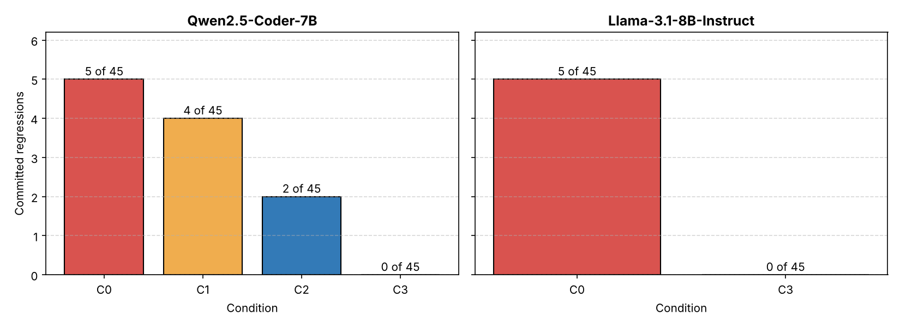
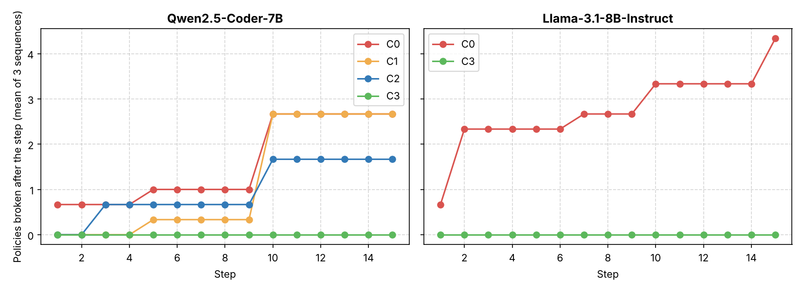
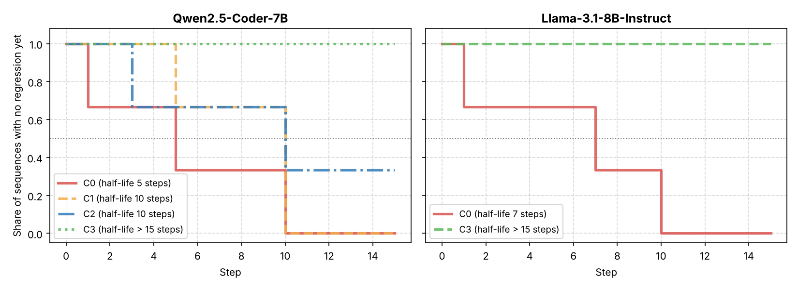
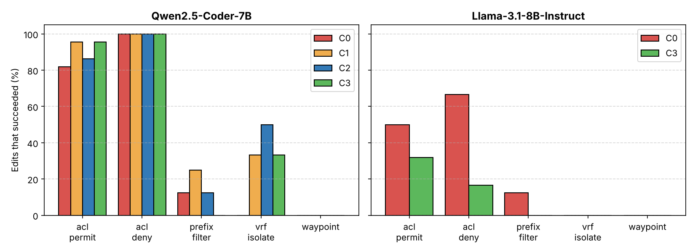

# Coherence Under Change: Measuring and Preventing Policy Drift When LLMs Edit Network Configurations

*Final report draft. Team: Akshith M, Jhithesh, Sanjaay. All numbers in this report are regenerated by
`python -m agent.analysis.report_figures` from the step logs in `guard/results_real/`.*

## Abstract

Large language models (LLMs) can write router configurations, but network operators make changes one after
another, and each change must keep every policy that earlier changes established. We study this setting:
a model receives a sequence of change requests for a network of Cisco IOS routers, and after every step we check
all policies accumulated so far. We built a test bed from real network maps (Internet Topology Zoo), a policy
checker cross-checked against the Batfish network verifier, a harness with four conditions (no help, feedback
with retries, a prompt that lists the policies at risk, and a full pre-commit guard), and a dependency map that
lets the guard re-check only the policies an edit can affect. On 3 sequences of 15 edits on the Abilene network,
Qwen2.5-Coder-7B and Llama-3.1-8B-Instruct each committed 5 edits that broke an earlier policy when nothing
checked them. Feedback with up to three retries left 4 such regressions for Qwen, listing the policies at risk
left 2, and the guard left none for either model. The guard's cost depends on the model: it rejected 36% of
Qwen's edits and 82% of Llama's. Feedback improves how many edits succeed; only checking before committing
removes drift. The checker agrees with Batfish on every comparison we made (30/30 hand-made cases, 162/162 on the
Topology Zoo networks, and 818/818 on the team's synthetic benchmark), and the dependency map missed none of 106
broken policies. The study is a pilot: three sequences, one network and two 7-8B models.

## 1. Introduction

Network configuration is a natural target for LLM assistance: configurations are text, the vocabulary is
regular, and operators already describe changes in natural language ("allow TCP 443 from the branch office to the
web servers"). Recent work shows that LLMs can synthesize and repair router configurations, especially when a
verifier checks their output [1][2][3]. Most of that work evaluates one change at a time.

Real operations are sequential. A network accumulates policies over months: this subnet must reach that server,
guest traffic must stay isolated, traffic to the payment servers must pass the firewall. Each new change is
written against the current configuration, and a change that is correct on its own can still break a policy set
many steps earlier, for example a new ACL line placed above an older one, or an OSPF cost change that moves
traffic off the firewall. We call this accumulation of broken earlier policies *drift*.

This project asks two questions:

1. **Measurement.** When an LLM applies a long sequence of configuration changes, how quickly does it break
   earlier policy? We measure committed regressions per step, policies broken over time, and the *regression
   half-life*: the median number of steps before a sequence's first committed regression.
2. **Prevention.** Does feedback from a checker stop drift, or is a pre-commit guard needed, one that verifies
   every tracked policy before an edit is applied and rejects edits that break one? What does the guard cost in
   rejected work and prompt length?

Contributions:

- A **test bed** built from three real network maps (17, 32 and 62 devices) with OSPF, ACLs, inbound route
  filters and VRFs; a **sequence generator** with five intent types, labelled trap variants and a rule that
  discards any step whose policy already holds before the edit.
- A **policy checker** (a Python reference engine) **validated against Batfish**, and a **dependency map** that
  records which devices, ACLs and routes each policy depends on, so an edit re-checks only affected policies.
- A **harness with four conditions** (C0-C3) and a **pre-commit guard**, run with two open 7-8B models on free
  Kaggle GPUs, with step-level resume so runs survive session limits.
- **Validation and audit tooling for the team's synthetic benchmark**: a Batfish oracle for its pipeline
  (818/818 agreement), a fix to its reference oracle, and an audit showing that 70% of its frozen test steps are
  already satisfied before the edit.

## 2. Related work

**LLM configuration synthesis with a verifier in the loop.** Mondal et al. [1] asked what LLMs need to
synthesize correct router configurations and combined GPT-4 with Batfish and syntax checkers, feeding errors back
to the model ("verified prompt programming"). NetConfEval [2] benchmarks LLMs on network configuration tasks
such as translating requirements into formal specifications and generating routing configurations. Lira et al.
[5] fine-tune small language models with LoRA to turn intents into verified configurations that run locally. These
works evaluate single requests; our feedback condition (C1) is the sequential analogue of the verifier loop.

**Configuration repair.** Cornetto [3] benchmarks LLM-driven repair of misconfigured networks of 20 to 754 nodes
across 231 scenarios and checks each fix for correctness and safety with formal data-plane verification; the
best model fully resolves about a quarter of scenarios. Asadli et al. [4] give models context retrieval,
iterative editing and verification tools and find that this agentic setup repairs more misconfigurations with
fewer regressions than single-shot prompting. Repair starts from a broken network; we start from a correct one
and measure how sequential changes break it.

**Misconfiguration detection.** CAIP [6] guides an LLM with context extracted from router configurations to
detect misconfigurations more accurately than partition-based prompting and classical checkers.

**Verification.** Batfish [7] builds a model of a network's control and data planes from configuration files
and answers reachability, traceroute and parse-status questions; we use it as the reference judge for our own
checker. Our networks are built from the Internet Topology Zoo [8].

**What is different here.** We focus on long sequences: drift accumulated over many edits, regressions of policies
set earlier in the same session, a guard that keeps a ledger of verified policies, and a dependency map that
keeps re-checking cheap as the ledger grows.

## 3. System design

### 3.1 Networks

| Network | Source | Core routers | Devices | Baseline policies | Role |
| --- | --- | --- | --- | --- | --- |
| 9-device bed | hand-built | 4 | 9 | 15 | prototype, frozen sequences, oracle cases |
| Abilene | Topology Zoo `Abilene.gml` | 11 | 17 | 20 | real-model runs, training data |
| BtEurope | Topology Zoo `BtEurope.gml` | 24 | 32 | 20 | training data |
| Cesnet | Topology Zoo `Cesnet201006.gml` | 52 | 62 | 20 | held out for testing |

The 9-device bed has a four-router OSPF ring (R1-R4), three edge routers (E1-E3) each owning a /24 host subnet,
and a firewall FW in front of a fourth edge router E4, so every path to E4 crosses FW. Its 15 baseline policies
are 8 reachability, 6 isolation and 1 waypoint policy.

On the Topology Zoo networks every map node becomes a core router running OSPF area 0 over /30 links. Edge routers
hang off spread-out core nodes, each with a host /24 behind an ACL and a guest /24 (10.2.k.0/24); one more host
subnet sits behind a firewall. All ACLs sit on edge devices, so equal-cost routing cannot change whether a flow is
permitted.

### 3.2 Policies and change requests

A policy (invariant) names a source subnet, a destination subnet, the traffic (a protocol and ports, or "ip" for a
set of probe flows: TCP 22, 80, 443, 8080, UDP 53 and ICMP) and a kind: **reach** (must be delivered),
**isolate** (must be blocked) or **waypoint** (must be delivered and every equal-cost path must cross a given
router).

Each step of a sequence is a natural-language change request with a machine-checkable intent and a gold patch:

| Intent type | Gold patch | Trap variants (labelled automatically) |
| --- | --- | --- |
| acl_permit / acl_deny | add an ACL line; a deny goes before the catch-all permit | prefix_overlap (rule too broad), shadowing (wrong position) |
| prefix_filter | inbound OSPF `distribute-list prefix` on the source's edge router, ending in a permit-all | prefix_overlap, implicit_deny (permit-all forgotten), shadowing |
| waypoint | raise OSPF costs on both ends of a link until every equal-cost path crosses router W | cost_wrong_end, over_steering |
| vrf_isolate | move a guest network into VRF GUEST (no route in or out) | isolation_leak (wrong interface), over_isolation (uplink moved too) |

A **trap** step is one where a plausible but careless edit provably breaks an earlier policy; the generator
records which mistake does it. Every gold patch is verified to achieve its intent and break nothing. On the
Topology Zoo networks a step's type is drawn from a target mix (40% permit, 15% each of the others), and a
candidate whose policy already holds before the edit is discarded, so a model cannot pass a step by changing
nothing. In the three Abilene sequences used below, 31 of 45 steps are traps.

### 3.3 The checker

The reference engine (`guard/cuc/engine.py`) parses a strict Cisco IOS subset and computes forwarding itself: OSPF
shortest paths with interface costs and equal-cost multipath, interface ACLs with first-match semantics and
implicit deny, inbound prefix-list route filters and VRFs. It traces each policy's flows hop by hop and reports
the result, the path, and on failure where the flow was denied or dropped. The parser is strict on purpose: an
unknown statement or a reference to an undefined ACL or VRF is a parse failure. The model's prompt lists the
allowed statements, so a statement outside that list counts as not following instructions.

The same `check(configs, policies)` interface is implemented on Batfish (`guard/cuc/batfish_backend.py`) using its
reachability and traceroute questions. Model runs use the reference engine because Batfish takes 4 to 12 seconds
per snapshot on the laptop used for validation; Batfish validates the engine on samples (Section 4).

### 3.4 Conditions and the guard

| Condition | What the model gets | What is committed |
| --- | --- | --- |
| C0 open loop | the change request and the configs of the devices it concerns | whatever parses, even if it breaks earlier policy |
| C1 reactive | C0, plus a counterexample (which policy broke, which flow, where) after a failed attempt; up to 3 retries | the last attempt that parses |
| C2 dependency-aware | C1, plus a list of the tracked policies whose dependencies touch the devices being edited | the last attempt that parses |
| C3 full guard | C1, plus a ledger of all verified policies | only an attempt that parses, breaks no tracked policy and achieves the intent; otherwise the step is rolled back and marked REJECTED |

Each step's outcome is SUCCESS, FORWARD_FAIL (intent not achieved), REGRESSION (an earlier policy broke), BOTH,
PARSE_FAIL or, under C3, REJECTED. In open-loop mode a broken state is kept, so drift accumulates.

### 3.5 Dependency map

For every policy the checker records its dependencies: the devices on every equal-cost path, the ACLs the flows
pass, and, for an isolation that holds because routing drops the flow (a route filter or VRF), the router where it
is dropped. An edit's footprint is the set of devices, ACLs and routing statements it changes. The guard re-checks
only policies whose dependencies overlap the footprint; a policy that breaks outside that set is a *miss*.

## 4. Validation of the checker

A drift measurement is only as good as its judge, so the reference engine was compared with Batfish before any
model was run.

| Check | Comparisons | Agree | What it covers |
| --- | --- | --- | --- |
| 30 hand-made oracle cases, 9-device bed | 30 | 30 | 10 safe, 10 breaking, 10 subtle edits; expected outcomes derived by hand, then checked by the engine and by Batfish |
| Baselines + sampled generated edits, 3 Zoo networks | 39 | 39 | correct, over-broad and misplaced versions of generated steps |
| Waypoint and VRF edits, 3 Zoo networks | 30 | 30 | the two routing intent types and their mistakes |
| Breaking mutations, 3 Zoo networks | 93 | 93 | deleted or flipped ACL lines, unbound ACLs, shut interfaces, dropped OSPF statements, broken route filters, OSPF costs and VRFs; 63 break at least one policy |

**Dependency map.** Over the 106 policies broken by the 93 mutations, the map built by the engine and the map
built from Batfish traceroute both missed none. The two maps flagged identical sets on 80 of 84 edits; on the other
4 the engine's map flagged one extra policy, so it errs toward re-checking. In 900 steps of a simulated model across
the three networks, 242 policies broke, the map missed none, and it flagged 6.9% of tracked policies per step, so
the guard could skip about 93% of re-checks.

**Problems found and fixed by validation.** Batfish cannot start a flow on a shut interface (handled the same way
in both judges); Batfish reports a route distinguisher (`rd`) under `ip vrf` as unrecognized syntax (the generator
no longer writes it); the first dependency-map measurement found 5 misses, all isolations enforced by a VRF, which
led to recording where routing drops a flow.

**Parser check on real model answers.** The models wrote 433 device configurations across C0-C3. The engine's
parser rejected 157; Batfish checked all 157 plus 15 accepted ones as controls. Batfish passed all 15 controls and
also flagged 88 of the rejected configurations. Of the 69 it passed:

| Why the parser rejected it | Configurations | Parser right? |
| --- | --- | --- |
| statements the prompt does not allow (ACL line without sequence number, `distribute-list ... out`, top-level `vrf NAME`, the port name `eq domain`) | 15 | yes: the model did not follow the instructions |
| configurations real IOS refuses or that change meaning (`ip vrf forwarding` after `ip address`, which removes the address; an undefined VRF; impossible prefix ranges such as `le 24` on a /24; a port on protocol `ip`) | 46 | yes: Batfish's parse status checks syntax only |
| valid IOS the parser refuses (a repeated `interface` section; a `! comment` line) | 8 | no |

Replaying the runs with those 8 accepted as IOS would accept them changes no outcome, because each of those
answers also contains another invalid line. Batfish's PASSED status is lenient (it passed lines such as
`ip vrf E3_VRF address ...`), so it is not proof of a valid configuration either.

## 5. Experimental setup

| Item | Setting |
| --- | --- |
| Models | Qwen2.5-Coder-7B-Instruct [9]; Llama-3.1-8B-Instruct [10] |
| Precision and hardware | 4-bit NF4 quantization (bitsandbytes), Kaggle 2x NVIDIA T4 (16 GB each); first Qwen runs on Google Colab T4 |
| Decoding | greedy (deterministic); output capped at the prompt length + 128 tokens, at most 2,048 |
| Sequences | Abilene, seeds 100-102, 15 steps each (45 edits per condition); 31 of 45 steps are traps |
| Conditions | Qwen: C0, C1, C2, C3. Llama: C0 and C3 |
| Retries | up to 3 for C1-C3 |
| Judge | reference engine (Section 4) |

Runs resume from the last finished step after an interruption, rebuilding the network state from the step log and
refusing to continue if the rebuilt state disagrees with the log. An interrupted C3 run was re-run from its saved
steps and reproduced the same outcome on every step.

## 6. Results

### 6.1 Headline numbers

| | Qwen C0 | Qwen C1 | Qwen C2 | Qwen C3 | Llama C0 | Llama C3 |
| --- | --- | --- | --- | --- | --- | --- |
| Edits that succeeded (of 45) | 25 | 31 | 29 | 29 | 16 | 8 |
| Committed regressions (of 45) | 5 | 4 | 2 | 0 | 5 | 0 |
| Sequences with a regression (of 3) | 3 | 3 | 2 | 0 | 3 | 0 |
| Policies broken after step 15 (per sequence) | 4, 1, 3 | 4, 3, 1 | 0, 3, 2 | 0, 0, 0 | 4, 2, 7 | 0, 0, 0 |
| Regression half-life (steps) | 5 | 10 | 10 | > 15 | 7 | > 15 |
| Edits rejected by the guard | - | - | - | 16 (36%) | - | 37 (82%) |
| Prompt tokens per step | 920 | 2,176 | 2,959 | 4,435 | 837 | 5,765 |
| Retries per step | 0 | 0.98 | 1.22 | 1.13 | 0 | 2.62 |



*Figure 1. Committed regressions per condition (edits that broke an earlier policy and were applied).*



*Figure 2. Mean number of policies broken after each step. Without a guard, broken policies accumulate and are
never repaired; under C3 the line stays at zero.*



*Figure 3. Share of sequences with no committed regression yet. The half-life is where a curve crosses 0.5; C3
never drops for either model.*

### 6.2 What happened at the regression steps

The five steps where Qwen broke a policy without help were one waypoint edit and four route-filter edits. Under
the other conditions:

| Sequence, step | Intent | C0 | C1 | C2 | C3 |
| --- | --- | --- | --- | --- | --- |
| s100, 5 | waypoint | broke policy, intent failed | broke policy, intent failed | invalid config | rejected |
| s100, 10 | route filter | broke policy | broke policy | succeeded | rejected |
| s101, 10 | route filter | broke policy, intent failed | broke policy, intent failed | broke policy, intent failed | rejected |
| s102, 1 | route filter | broke policy | invalid config | invalid config | rejected |
| s102, 10 | route filter | broke policy | broke policy | invalid config | rejected |

C2 also broke a policy at one step where C0 had not (s102, step 3, a route filter). Llama's five regressions without
a guard were at s100 step 7 (ACL permit), s100 step 15, s101 step 10 and s102 step 1 (route filters) and s102 step 2
(waypoint); the guard rejected all five.

### 6.3 Findings

1. **Drift is real for both models.** Without a check, every sequence of both models ended with broken policies,
   up to 7 for Llama. Nothing in the open loop notices or repairs them (no regression was repaired in any run).
2. **Feedback raises success, not safety.** C1 completed 6 more edits than C0 by fixing mistakes on retry, but still
   committed a regression at 4 of the 5 steps where C0 did. When a model cannot write a correct route filter, three
   more attempts do not help.
3. **Listing the affected policies halves drift but does not remove it.** C2 had 2 regressions instead of 4 and got
   one route filter right that C0 and C1 broke.
4. **Only the guard removes drift, at a cost that depends on the model.** C3 had no committed regression for either
   model. It intercepted 3 first attempts that would have broken a policy for Qwen and 10 for Llama. For Qwen the
   guard cost nothing in completed work (29 successes against 25 in C0); for Llama it halved it (8 against 16),
   because most of Llama's C3 answers were invalid configurations (33 of 45 final attempts) under prompts of about
   5,800 tokens with the ledger and feedback.
5. **Prompt length is the price of context.** Prompts grow from about 900 tokens (C0) to 2,200 (C1), 3,000 (C2) and
   4,400-5,800 (C3). The dependency map keeps the checking cost small, but the ledger in the prompt does not.

With three sequences per condition these are counts from a pilot. A paired bootstrap over sequences puts C3 at 2.7
fewer broken policies after step 15 than C0 for Qwen and 4.3 fewer for Llama, but with three sequences such
intervals are coarse; the counts above are the result to rely on.

## 7. Failure analysis



*Figure 4. Share of edits that succeeded, by intent type and condition.*

| Intent type (steps) | Qwen C0 | Qwen C1 | Qwen C2 | Qwen C3 | Llama C0 | Llama C3 |
| --- | --- | --- | --- | --- | --- | --- |
| acl_permit (22) | 18 | 21 | 19 | 21 | 11 | 7 |
| acl_deny (6) | 6 | 6 | 6 | 6 | 4 | 1 |
| prefix_filter (8) | 1 | 2 | 1 | 0 | 1 | 0 |
| vrf_isolate (6) | 0 | 2 | 3 | 2 | 0 | 0 |
| waypoint (3) | 0 | 0 | 0 | 0 | 0 | 0 |

**ACL edits are easy; routing edits are not.** Qwen completed 24 to 27 of 28 ACL edits in every condition. Route
filters succeeded at most 2 times in 8, VRF isolation at most 3 in 6, and no model completed a waypoint edit in any
condition. Routing edits require reasoning about the whole network: a waypoint needs OSPF costs raised at both ends
of the right links, and a route filter needs a prefix list that ends in a permit-all line.

**Regressions come from traps.** Every committed regression of Qwen and four of Llama's five fell on a trap step,
the steps where the generator had proved that a plausible mistake breaks an earlier policy. The models made those
mistakes. Most broken route filters dropped more routes than intended, so flows of earlier reachability policies
now ended in "no route" (the trap labels: a missing permit-all line or a prefix that is too broad). Qwen's broken
waypoint edit raised costs on the wrong links: traffic was rerouted around the firewall, and flows its ACL used to
block were delivered. Llama's one regression outside a trap was an ordinary ACL permit edit that broke an earlier
policy.

**Invalid configurations.** Most failures were configurations the checker could not accept. The common causes, seen
in the parser check, were VRF syntax (`ip vrf forwarding` placed after `ip address`, undefined VRFs, an `ip vrf`
line inside an interface), impossible prefix-list ranges, ACL lines without sequence numbers, and statements outside
the allowed list. Under C3 the guard rejected Qwen's edits mostly for this reason (14 of 16 rejected steps ended with
an invalid configuration) and Llama's almost entirely (33 of 37).

**Why Llama struggles under the guard.** Llama's C3 prompts averaged 5,765 tokens and it needed 2.62 retries per
step; each failed attempt adds feedback to the next prompt. Its ACL success dropped from 15 of 28 (C0) to 8 of 28
(C3). A stronger or longer-context model, or a guard that sends only the policies at risk instead of the whole
ledger, are the obvious next steps.

## 8. The team's synthetic benchmark

The team also built a synthetic benchmark (`generator/`): four synthetic topologies with static routes and VRFs,
the five intent types, three trap kinds, 44 frozen test sequences with SHA-256 integrity checks, disjoint training
and test paraphrases, and a training-data export of 500 examples. Two pieces of Track A connect to it:

- **Batfish oracle.** `generator/oracle/batfish.py` implements the benchmark's oracle interface on Batfish with the
  same flow rules as its reference oracle. On two frozen test sequences (gold replay every 10 steps plus 4 trap edits
  each) the two oracles agreed on 818 of 818 verdicts, and Batfish confirmed all 8 trap proofs.
- **Reference oracle fix.** The benchmark's reference oracle ignored ACL lines that start with a sequence number
  (`10 permit ...`), which most models write. It now reads them; the frozen data is unaffected (all 44 sequences
  regenerate identically).

**Audit.** `python -m generator.audit_trivial` checks, for every frozen test step, whether the new policy already
holds before the gold patch. It does on **1,822 of 2,600 steps (70%)**: every regular permit step (the baseline ACL
already ends in `permit ip any any`), every prefix-filter step (the filtered prefix does not exist in the network and
the test source lies outside it), every VRF-isolation step and every waypoint step. A model that changes nothing
would satisfy the new intent on those steps. Only regular deny steps are all non-trivial. For this reason the
team's headline results use the Topology Zoo benchmark, whose generator discards such steps; making the synthetic
benchmark non-trivial (and regenerating its frozen data and training export) is future work.

## 9. Independent review

The roadmap requires the policies and oracle cases to be reviewed by someone other than their author. Jhithesh
reviewed the 15 baseline policies of the 9-device bed individually, tracing each to the ACL line or routing that
enforces it, and agreed with all 15 (`docs/INDEPENDENT_AUDIT_CHECKLIST.md`). The 30 oracle cases were reviewed in
three groups (safe, breaking, subtle) rather than case by case; all three groups were agreed.

## 10. Limitations

- **Size.** Three sequences of 15 steps on one network per condition. The direction of every result is consistent
  across sequences, but the numbers are not precise estimates.
- **Models.** Two open 7-8B models in 4-bit precision; Llama ran only C0 and C3. Larger or API models may drift less
  and be rejected less.
- **Networks.** Real-model runs used Abilene only; BtEurope and Cesnet were used for validation and training data, and
  the held-out Cesnet network was not run with a model.
- **Judge during runs.** Runs use the reference engine, validated against Batfish on samples rather than on every
  step. The engine tests one host per subnet and six probe flows, while Batfish reasons over all headers.
- **Strict parser.** The parser rejects 8 kinds of valid IOS that the prompt does not allow (Section 4); this changed
  no outcome in our runs.
- **No fine-tuning.** The training-data pipelines exist (both benchmarks), but no fine-tuned model was evaluated.
- **Synthetic benchmark.** 70% of its frozen steps are trivially satisfied (Section 8).

## 11. Conclusion

Applying configuration changes one after another, two open 7-8B models broke earlier network policy within a few
steps when nothing checked them: 5 committed regressions in 45 edits each, never repaired. Feedback with retries
made the models complete more edits but barely reduced drift; telling the model which policies were at risk halved
it; only verifying every tracked policy before committing removed it. The guard is cheap to check thanks to the
dependency map, which re-checks about 7% of policies per edit without missing any, but its cost in rejected work
depends on the model. The checker behind these numbers agrees with Batfish on every comparison we made. The next
step is scale: more sequences, the held-out network, stronger models, and a guard that repairs rather than only
rejects.

## Team contributions

- **Akshith M (Track A):** test beds, checker and Batfish validation, sequence generator for the Topology Zoo
  networks, harness and guard, dependency map, real-model runs on Kaggle, parser check, Batfish oracle and audit for
  the synthetic benchmark.
- **Jhithesh (agent logic, experiments, writing):** agent framework (prompt builder, answer parser, logging, dry
  run), metrics and figures, report, independent review.
- **Sanjaay (data and models):** synthetic benchmark generator and training-data export, model baselines.

*[Team to confirm before submission.]*

## References

[1] R. Mondal, A. Tang, R. Beckett, T. Millstein, G. Varghese. What do LLMs need to synthesize correct router
configurations? ACM HotNets 2023. arXiv:2307.04945.

[2] C. Wang, M. Scazzariello, A. Farshin, S. Ferlin, D. Kostić, M. Chiesa. NetConfEval: Can LLMs facilitate network
configuration? Proceedings of the ACM on Networking (CoNEXT), 2024. doi:10.1145/3656296.

[3] I. Protogeros, R. Asadli, B. Hoffman, L. Vanbever. Benchmarking LLM-driven network configuration repair.
arXiv:2604.22513, 2026.

[4] R. Asadli, B. Hoffman, I. Protogeros, L. Vanbever. Evaluating agentic configuration repair for computer
networks. AIWILD workshop at ICML 2026. arXiv:2606.06212.

[5] O. G. Lira, O. M. Caicedo, N. L. S. da Fonseca. Network self-configuration based on fine-tuned small language
models. arXiv:2512.02861, 2025.

[6] X. Jiang, A. Gember-Jacobson, N. Feamster. CAIP: Detecting router misconfigurations with context-aware iterative
prompting of LLMs. arXiv:2411.14283, 2024.

[7] A. Fogel, S. Fung, L. Pedrosa, M. Walraed-Sullivan, R. Govindan, R. Mahajan, T. Millstein. A general approach to
network configuration analysis. USENIX NSDI 2015.

[8] S. Knight, H. X. Nguyen, N. Falkner, R. Bowden, M. Roughan. The Internet Topology Zoo. IEEE Journal on Selected
Areas in Communications, 29(9), 2011.

[9] B. Hui et al. Qwen2.5-Coder technical report. arXiv:2409.12186, 2024.

[10] A. Grattafiori et al. The Llama 3 herd of models. arXiv:2407.21783, 2024.

## Appendix A. Reproducing the results

```bash
# checker and validation (Batfish: docker run -d --name batfish -p 8888:8888 -p 9997:9997 -p 9996:9996 batfish/allinone)
cd guard
python3 -m unittest discover -s tests                 # 28 unit tests
python3 scripts/run_oracle.py                         # 30 of 30 oracle cases
python3 scripts/validate_against_batfish.py           # 30 of 30: human, checker and Batfish
python3 scripts/validate_zoo_batfish.py 4             # 39 of 39 on the three Zoo networks
python3 scripts/validate_zoo_batfish.py 3 wp vrf      # 30 of 30, waypoint and VRF intents
python3 scripts/validate_zoo_mutations.py 3           # 93 of 93 breaking edits
python3 scripts/validate_depmap_batfish.py            # dependency map: 0 misses, both maps
python3 scripts/batfish_parse_audit.py results_real   # parser vs Batfish on the model answers
python3 scripts/summarize_runs.py results_real        # results table + paired bootstrap
cd ..
# model runs: guard/notebooks/kaggle_runs.ipynb (Qwen) and kaggle_llama.ipynb (Llama), Save & Run All on Kaggle
python -m agent.analysis.report_figures               # figures and numbers in this report
python -m generator.oracle.validate_batfish           # synthetic benchmark: Batfish vs reference oracle
python -m generator.audit_trivial                     # synthetic benchmark: already-true steps
```
